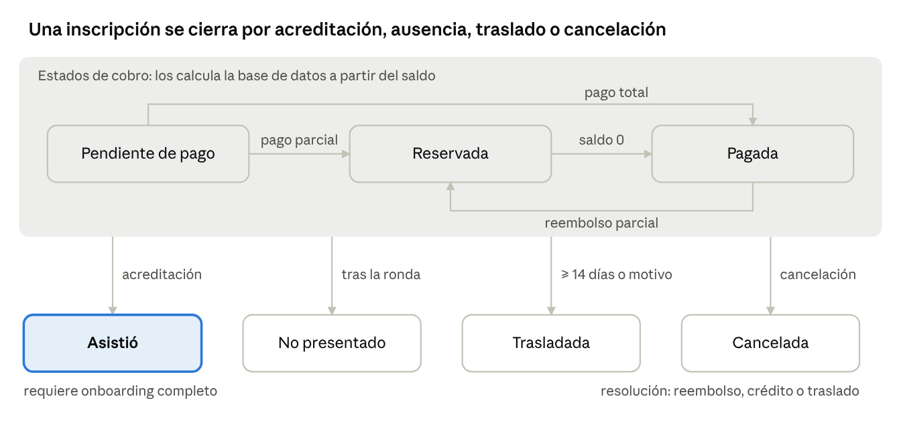

# RUKC · Base de datos — Diseño detallado

Oct 30, 2026 · @John

## Estado y versiones

Versión vigente: __v1\.0, aprobada el 30 oct 2026__\. Cada mejora sube la versión \(v1\.1, v1\.2…\) y se anota en esta tabla\.

Versión

Fecha

Cambio

v1\.0

30 oct 2026

Aprobada\. Responsable del tratamiento sin publicar \(riesgo aceptado\)\. Franja 80,1–84,9 kg: elección para toda la temporada; el esquema admite una inscripción por piloto, ronda y categoría\.

v0\.4

30 oct 2026

Diseño detallado: tablas, estados, flujos, panel, seguridad y RGPD\. Stack opción D \(Vercel Pro \+ Neon gratis\)\.

v0\.3

30 oct 2026

Captura de borradores, franja de categoría 80–85 kg, seguro por circuito, asunción de riesgos al final del onboarding\.

v0\.2

30 oct 2026

Diseño general: arquitectura, principios y mapa de entidades\.

v0\.1

30 oct 2026

Preguntas de fase 1 y supuestos\.

## Stack y decisiones vigentes

La web se queda como está \(Astro 7 estático en Vercel Pro, funciones en api/\) y se añade una base de datos Postgres en Neon\. Coste fijo nuevo: 0 €\.

Pieza

Elección

Motivo

Base de datos

Neon Postgres, plan gratuito, región UE \(Fráncfort\)

0,5 GB y 100 horas de cómputo al mes; se suspende tras 5 min sin uso y despierta sola \([Neon](https://neon\.com/faqs/managed\-postgres\-databases\-free\-tier)\)

Acceso a datos

@neondatabase/serverless desde las funciones, consultas SQL parametrizadas

Pensado para funciones sin servidor; sin ORM que duplique el esquema

Migraciones

Archivos SQL numerados en db/migrations/ \+ script que los aplica en orden

El esquema vive en un solo sitio y queda versionado en Git

Login del panel

Better Auth instalado en el propio repo \(email \+ contraseña \+ segundo factor TOTP\), tablas en Neon

La versión gestionada de Neon está en beta y no lista el plugin de segundo factor \([Neon](https://neon\.com/docs/auth/roadmap)\)

Fotos y justificantes

Vercel Blob en un almacén __privado__

Lectura siempre autenticada \([Vercel](https://vercel\.com/changelog/private\-storage\-for\-vercel\-blob\-now\-available\-in\-public\-beta)\); en Pro se paga con el crédito mensual incluido

Tareas programadas

Vercel Cron

Pro permite hasta 100 tareas por proyecto con precisión de minuto, en UTC y sin reintentos \([Vercel](https://vercel\.com/docs/cron\-jobs/usage\-and\-pricing)\)

Pagos

Stripe Checkout \(como hoy\) \+ registro manual de Bizum, transferencia y efectivo

Sin cambio para el cliente

Abandono de pago

Sesión de Checkout con caducidad de 30 min \+ evento checkout\.session\.expired

30 min es el mínimo que permite Stripe \([Stripe](https://docs\.stripe\.com/payments/checkout/abandoned\-carts?payment\-ui=stripe\-hosted)\)

__Decisiones de negocio que el diseño ya recoge:__

- Cada pago compra una ronda concreta\. Se puede mover de fecha avisando con al menos 14 días\.
- Si una ronda no se celebra, se devuelve el dinero \(o crédito, si el piloto lo prefiere\)\.
- Una persona puede pagar por otras\.
- La temporada se paga de golpe; el resto en circuito \(69 €\) se cobra casi siempre en efectivo\.
- La edad mínima la fija cada circuito\.
- Abrir y cerrar inscripciones por categoría es manual; el sistema avisa pero no bloquea\.
- El seguro es el del circuito\.
- Se capturan borradores del formulario \(consultado con abogado\)\.
- Un solo administrador; roles preparados para un operador futuro\.

## Convenciones del esquema

Todas las tablas siguen las mismas reglas, para que cualquier módulo futuro encaje sin excepciones\.

Regla

Detalle

Nombres

Español, minúsculas, snake\_case, tablas en singular \(inscripcion\)

Clave primaria

id uuid DEFAULT gen\_random\_uuid\(\)

Código legible

Donde una persona lo dicta o lo busca: codigo text UNIQUE \(p\. ej\. T2\-R2\-0043, RK\-7K3P\)

Fechas

timestamptz siempre; se muestran en Europe/Madrid\. Fechas sin hora \(fecha de ronda, nacimiento\): date

Dinero

integer en céntimos, columnas terminadas en \_cent, siempre ≥ 0 salvo en el libro de créditos

Pesos

numeric\(5,1\) en kg

Enumerados

text \+ CHECK \(col IN \(\.\.\.\)\)\. Añadir un valor = una migración

Columnas comunes

creado\_en, actualizado\_en \(trigger\), creado\_por \(publico, sistema, admin:<id>\)

Borrado

Nunca físico en tablas de negocio\. Estados terminales o anonimizada\. Excepción: borradores caducados

Historial

Cambios de estado y de dinero escriben una fila en evento \(solo añadir\) desde triggers

Integridad

Claves foráneas con ON DELETE RESTRICT; reglas de estado y sumas comprobadas en la base de datos, no solo en la interfaz

Datos sensibles

En tablas aparte \(datos\_sensibles\_piloto\), excluidos de exportaciones por defecto\. El número de documento va cifrado

## Tablas: identidad y captación

Una persona existe una sola vez, aunque sea lead, piloto, pagador y tutor a la vez\. Se identifica por teléfono y, si no hay, por email\.

### persona

Columna

Tipo

Reglas

nombre

text

NOT NULL

apellidos

text

email

citext

UNIQUE

telefono

text

UNIQUE, formato E\.164 \(\+34\.\.\.\)

municipio

text

Opcional

instagram

text

Opcional

origen\_alta

text

formulario\_web · alta\_manual · onboarding · importacion

estado

text

activa · anonimizada

anonimizada\_en

timestamptz

notas

text

Solo admin

Regla: email o teléfono obligatorio salvo si está anonimizada\.

### perfil\_piloto \(1:1 con persona\)

Columna

Tipo

Reglas

persona\_id

uuid

PK y FK a persona

nombre\_competicion

text

NOT NULL; por defecto nombre \+ inicial del apellido

foto\_blob\_path

text

Ruta en el almacén privado

experiencia

text

ninguna · ocasional · amateur · competicion

frecuencia

text

ocasional · mensual · semanal · varias\_por\_semana

ligas\_previas

text

Solo si experiencia es amateur o competición

circuitos\_rodados

text\[\]

Opcional

altura\_cm

smallint

Opcional, 120–230

objetivo

text

Opcional

como\_nos\_conocio

text

Solo si no hay atribución automática

comentarios

text

"Dudas o preferencias"; sin pedir datos de salud

### dorsal\_temporada

Columna

Tipo

Reglas

temporada\_id

uuid

FK

persona\_id

uuid

FK

dorsal

smallint

1–999

UNIQUE \(temporada, dorsal\) y UNIQUE \(temporada, persona\): cada piloto tiene un dorsal por temporada y ninguno se repite\.

### datos\_sensibles\_piloto \(1:1, acceso restringido\)

Columna

Tipo

Reglas

persona\_id

uuid

PK y FK

fecha\_nacimiento

date

NOT NULL

documento\_tipo

text

dni · nie · pasaporte

documento\_cifrado

bytea

AES\-256\-GCM, clave en variable de entorno

documento\_ultimos3

text

Para identificar sin descifrar

peso\_declarado\_kg

numeric\(5,1\)

30–200; solo si hay consentimiento de peso vigente

peso\_declarado\_en

timestamptz

emergencia\_nombre

text

NOT NULL

emergencia\_telefono

text

NOT NULL

emergencia\_relacion

text

Opcional

### tutela

Columna

Tipo

Reglas

menor\_persona\_id

uuid

PK compuesta, FK

tutor\_persona\_id

uuid

PK compuesta, FK

relacion

text

padre · madre · tutor\_legal

### atribucion

Una fila por cada contacto con origen conocido; las vistas sacan el primero y el último\.

Columna

Tipo

Reglas

persona\_id

uuid

FK, nullable

solicitud\_id

uuid

FK, nullable; una de las dos obligatoria

canal

text

meta\_ads · instagram · whatsapp · web\_directa · referido · circuito · otro

utm\_source, utm\_medium, utm\_campaign, utm\_content, utm\_term

text

fbclid, fbc, fbp

text

Solo si hay consentimiento de cookies

landing\_path, referrer

text

capturada\_en

timestamptz

### oportunidad \(embudo comercial\)

Columna

Tipo

Reglas

persona\_id

uuid

FK

temporada\_id

uuid

FK; UNIQUE \(persona, temporada\)

etapa

text

nueva · contactada · interesada · ganada · perdida · sin\_respuesta

origen

text

formulario\_web · alta\_manual

proxima\_accion

text

proxima\_accion\_en

timestamptz

motivo\_perdida

text

Obligatorio si perdida

cerrada\_en

timestamptz

### interaccion \(línea de tiempo\)

Columna

Tipo

Reglas

persona\_id

uuid

FK

oportunidad\_id

uuid

FK, nullable

tipo

text

nota · llamada · whatsapp\_entrante · whatsapp\_saliente · instagram · email · presencial

resumen

text

NOT NULL

ocurrida\_en

timestamptz

NOT NULL

admin\_id

uuid

FK

## Tablas: catálogo

Calendario, precios, categorías y cupos son datos editables desde el panel; nada de esto vive en el código\. La reserva de 30 € no es un producto: es un importe a cuenta de la ronda, fijado por temporada\.

### temporada

Columna

Tipo

Reglas

codigo

text

UNIQUE \(T2\)

nombre

text

inicio, fin

date

estado

text

borrador · abierta · en\_curso · cerrada

importe\_reserva\_cent

integer

3000 en T2

dias\_aviso\_traslado

smallint

14 en T2

franja\_ambas\_categorias

boolean

Si un piloto de la franja 80,1–84,9 kg puede inscribirse en las dos categorías \(regla 1\)

enlace\_grupo\_whatsapp

text

Solo lo ven el admin y los pilotos aprobados

plantilla\_feedback\_id

uuid

FK

### circuito

Columna

Tipo

Reglas

nombre

text

UNIQUE

municipio

text

edad\_minima

smallint

La que fije el circuito

seguro\_aseguradora

text

seguro\_cubre\_terceros

text

si · no · sin\_confirmar \(defecto\)

seguro\_confirmado\_en

date

seguro\_documento\_path

text

Almacén privado

activo

boolean

### ronda

Columna

Tipo

Reglas

temporada\_id

uuid

FK; UNIQUE \(temporada, numero\)

numero

smallint

1–8

circuito\_id

uuid

FK

fecha

date

hora\_inicio

time

Nullable: varía por ronda

estado

text

programada · aplazada · celebrada · cancelada

puntuable

boolean

notas

text

P\. ej\. "Final y gala"

### categoria

Columna

Tipo

Reglas

temporada\_id

uuid

FK

codigo

text

LIG · PES; UNIQUE \(temporada, codigo\)

nombre

text

Ligeros · Pesados

peso\_minimo\_kg

numeric\(5,1\)

70,0 y 85,0: quien pese menos lleva lastre hasta aquí

orden

smallint

### regla\_categoria

Decide la categoría a partir del peso con equipo\. Se lee en orden ascendente de hasta\_kg; la primera fila que cumple manda\.

hasta\_kg \(incluido\)

resultado

80,0

LIG

84,9

eleccion \(el piloto elige LIG bajando a 80,0 o PES con lastre hasta 85,0\)

sin límite

PES

### cupo\_ronda

Columna

Tipo

Reglas

ronda\_id, categoria\_id

uuid

PK compuesta

plazas

smallint

50 por defecto

estado\_inscripcion

text

abierta · cerrada · lista\_espera\. Lo mueve solo el admin

### producto y tarifa

Columna \(producto\)

Tipo

Reglas

temporada\_id

uuid

FK

codigo

text

carrera\_suelta · temporada\_completa · temporada\_resto

rondas\_incluidas

smallint

1, 8 o las que queden

activo

boolean

Columna \(tarifa\)

Tipo

Reglas

producto\_id

uuid

FK

precio\_cent

integer

9900 · 69000 · 63000 en T2

vigente\_desde

timestamptz

vigente\_hasta

timestamptz

Nullable; sin solapes por producto

### codigo\_descuento

Columna

Tipo

Reglas

codigo

text

UNIQUE, mayúsculas

tipo

text

porcentaje · importe\_fijo

valor

integer

% \(1–100\) o céntimos

productos

text\[\]

Nullable = todos

usos\_maximos

integer

Nullable = ilimitado

valido\_desde, valido\_hasta

timestamptz

activo

boolean

### regla\_grupo

Columna

Tipo

Reglas

temporada\_id

uuid

FK

min\_pilotos

smallint

Valores pendientes de definir

tipo, valor

text, integer

Como en codigo\_descuento

activo

boolean

## Tablas: venta y dinero

La inscripción \(un piloto en una ronda\) es el centro\. Un pedido agrupa inscripciones de un pagador; cada pago se reparte entre inscripciones con aplicacion\_pago, así un pago puede cubrir varias rondas o pilotos y una ronda puede pagarse en dos veces \(30 \+ 69\)\.

### solicitud\_inscripcion \(embudo del formulario web\)

Columna

Tipo

Reglas

codigo

text

UNIQUE, RK\- \+ 4 caracteres sin ambiguos\. Es el concepto del Bizum

estado

text

Ver Estados

temporada\_id, ronda\_id

uuid

FK; ronda nullable en borrador

categoria\_elegida

text

LIG · PES · no\_se

pagador\_nombre, pagador\_email, pagador\_telefono

text

Tal como se escribieron

piloto\_es\_pagador

boolean

Defecto true

piloto\_nombre, piloto\_telefono

text

Si paga por otra persona

metodo\_elegido

text

tarjeta · bizum

persona\_id

uuid

Coincidencia por teléfono o email; nunca sobrescribe datos existentes

borrador\_token\_hash

text

Permite al navegador seguir editando su propio borrador

paso\_actual

smallint

acepta\_documentos

jsonb

Versiones de condiciones y privacidad aceptadas

acepta\_comunicaciones

boolean

Casilla separada, desmarcada por defecto

consentimiento\_medicion

boolean

Copia del consentimiento de cookies

stripe\_checkout\_session\_id

text

UNIQUE

checkout\_expira\_en

timestamptz

Creación \+ 30 min

ultimo\_guardado\_en, enviada\_en, pagada\_en, abandonada\_en

timestamptz

pedido\_id

uuid

Al convertirse

ip\_hash, user\_agent

text

Evidencia del consentimiento

### pedido

Columna

Tipo

Reglas

codigo

text

UNIQUE

temporada\_id

uuid

FK

pagador\_persona\_id

uuid

FK

origen

text

web · manual

solicitud\_id

uuid

Nullable

codigo\_descuento\_id, regla\_grupo\_id

uuid

Nullable

subtotal\_cent, descuento\_cent, total\_cent

integer

total = subtotal − descuento

estado

text

Calculado: abierto · pagado\_parcial · pagado · cancelado

### inscripcion

Columna

Tipo

Reglas

codigo

text

UNIQUE \(T2\-R2\-0043\)

pedido\_id

uuid

FK

piloto\_persona\_id

uuid

FK

ronda\_id

uuid

FK

producto\_id

uuid

Con qué se vendió

precio\_cent

integer

Carrera suelta 9900\. Temporada: total repartido entre sus rondas; la última absorbe el redondeo

categoria\_id

uuid

Nullable hasta saberla

categoria\_origen

text

por\_peso · eleccion\_franja · pendiente

estado

text

Ver Estados

resolucion

text

Si se cancela: pendiente · reembolso · credito · traslado · sin\_devolucion

sobrecupo

boolean

Se marca si al crearse la categoría ya estaba llena

motivo

text

De cancelación o excepción

UNIQUE \(piloto, ronda, categoría\) mientras la inscripción esté activa\. Cuántas categorías puede usar un piloto de la franja 80,1–84,9 kg lo fija la regla 1 de Reglas pendientes, no el esquema\. El saldo pendiente no se guarda: se calcula \(precio − pagos aplicados − créditos canjeados\)\.

### pago

Columna

Tipo

Reglas

codigo

text

UNIQUE

pagador\_persona\_id

uuid

FK

entidad\_cobradora\_id

uuid

FK

metodo

text

stripe\_tarjeta · stripe\_bizum · stripe\_otro · bizum\_manual · transferencia · efectivo

importe\_cent

integer

> 0

estado

text

Ver Estados

recibido\_en, confirmado\_en

timestamptz

confirmado\_por

text

stripe o admin:<id>

stripe\_payment\_intent\_id

text

UNIQUE

stripe\_checkout\_session\_id

text

referencia\_externa

text

Concepto del Bizum o de la transferencia

justificante\_path

text

Almacén privado

cobrado\_por

text

En efectivo: quién lo recibió

ronda\_id

uuid

Si se cobró en el circuito

factura\_ref

text

Número de la factura emitida en el software externo

### aplicacion\_pago

Columna

Tipo

Reglas

pago\_id, inscripcion\_id

uuid

PK compuesta

importe\_cent

integer

> 0

Triggers: lo aplicado de un pago no supera su importe menos lo reembolsado, y lo aplicado a una inscripción no supera su precio\.

### movimiento\_credito \(libro de créditos\)

Columna

Tipo

Reglas

persona\_id

uuid

FK

importe\_cent

integer

\+ abono, − canje

tipo

text

fidelidad · compensacion\_cancelacion · canje · caducidad · ajuste

inscripcion\_id

uuid

En canjes y compensaciones

caduca\_en

timestamptz

Nullable

motivo

text

Obligatorio en ajuste

El saldo es la suma; un trigger impide que baje de cero\.

### reembolso

Columna

Tipo

Reglas

pago\_id

uuid

FK

importe\_cent

integer

> 0

estado

text

pendiente · emitido · fallido

stripe\_refund\_id

text

Si fue por Stripe

emitido\_en

timestamptz

motivo

text

NOT NULL

### traslado

Columna

Tipo

Reglas

inscripcion\_origen\_id, inscripcion\_destino\_id

uuid

FK

solicitado\_en

timestamptz

Cuándo avisó el piloto

dias\_antelacion

integer

Fecha de la ronda origen − aviso

fuera\_de\_plazo

boolean

Menos días que dias\_aviso\_traslado

motivo\_excepcion

text

Obligatorio si fuera de plazo

### entidad\_cobradora

Columna

Tipo

Reglas

nombre\_comercial

text

RUKC

titular\_legal

text

Hoy, la titular de la cuenta de Stripe; después, la sociedad

nif

text

tipo

text

persona\_fisica · empresa · sociedad

activa\_desde, activa\_hasta

date

Una sola activa para los cobros nuevos

### stripe\_evento

Columna

Tipo

Reglas

stripe\_event\_id

text

PK: un evento de Stripe se procesa una sola vez

tipo

text

recibido\_en, procesado\_en

timestamptz

error

text

## Tablas: onboarding, feedback y sistema

Cada documento legal tiene versiones y cada aceptación guarda qué versión exacta se aceptó, quién firmó y con qué evidencia\. Las aceptaciones nunca se editan: solo se revocan\.

### documento\_legal

Columna

Tipo

Reglas

tipo

text

asuncion\_riesgos · cesion\_imagen · reglamento · privacidad · condiciones\_reserva · consentimiento\_peso · aviso\_borradores

version

text

UNIQUE \(tipo, version\)

titulo, contenido\_md

text

hash\_sha256

text

Del contenido exacto

vigente\_desde, vigente\_hasta

timestamptz

Una vigente por tipo

obligatorio\_onboarding

boolean

revocable

boolean

Imagen y peso sí; riesgos y reglamento no

revisado\_abogado\_en

date

No se activa sin esta fecha

### aceptacion

Columna

Tipo

Reglas

persona\_id

uuid

Titular \(el piloto\)

firmante\_persona\_id

uuid

El piloto o su tutor

documento\_legal\_id

uuid

FK a la versión exacta

aceptado

boolean

En cesión de imagen puede ser false

opciones

jsonb

Imagen: web, redes, anuncios por separado

contexto

text

formulario\_web · onboarding · acreditacion\_ronda · manual

ronda\_id

uuid

En ratificaciones por ronda

nombre\_tecleado

text

documento\_ultimos3

text

Del DNI del firmante

documento\_hash, ip, user\_agent

text

Evidencia

aceptada\_en

timestamptz

revocada\_en

timestamptz

Única columna modificable

### onboarding

Columna

Tipo

Reglas

persona\_id, temporada\_id

uuid

UNIQUE juntos

estado

text

Ver Estados

token\_hash

text

UNIQUE; el enlace personal

token\_expira\_en

timestamptz

Fin de temporada

paso\_actual

smallint

borrador

jsonb

Autoguardado entre pasos

enlace\_enviado\_en, iniciado\_en, completado\_en

timestamptz

### acceso\_grupo

Columna

Tipo

Reglas

persona\_id, temporada\_id

uuid

UNIQUE juntos

estado

text

Ver Estados

solicitado\_en, decidido\_en

timestamptz

decidido\_por

uuid

Admin

motivo\_rechazo

text

Obligatorio si se rechaza

enlace\_enviado\_en, dentro\_en, salida\_en

timestamptz

### formacion\_modulo y formacion\_progreso \(borrador\)

Tabla

Columnas

formacion\_modulo

temporada\_id, titulo, url, orden, obligatorio, activo

formacion\_progreso

persona\_id \+ modulo\_id \(PK\), visto\_en

El paso de formación aparece en el onboarding solo cuando haya algún módulo activo\.

### pesaje \(preparado, sin pantalla en v1\)

Columna

Tipo

Reglas

inscripcion\_id

uuid

UNIQUE

peso\_kg, lastre\_kg

numeric\(5,1\)

categoria\_id

uuid

La que resulta del pesaje

pesado\_en, pesado\_por

timestamptz, text

### plantilla\_feedback, envio\_feedback y respuesta\_feedback

Tabla

Columnas clave

Reglas

plantilla\_feedback

version, preguntas \(jsonb: id, tipo, texto, obligatoria, opciones\), activa

Tipos: escala\_0\_10, escala\_1\_5, opcion\_unica, opcion\_multiple, texto\. Una plantilla usada no se edita: se crea otra versión

envio\_feedback

inscripcion\_id \(UNIQUE\), plantilla\_id, estado, token\_hash, enviado\_en, canal, abierto\_en, respondido\_en, recordatorio\_en, expira\_en

Solo para inscripciones con estado asistio

respuesta\_feedback

envio\_id \+ pregunta\_id \(PK\), valor\_num, valor\_texto, valor\_opciones

Una fila por pregunta, para poder filtrar por respuesta

### Sistema

Tabla

Columnas clave

Para qué

admin

email, nombre, rol \(propietario · operador\), activo

Usuarios del panel \(sobre las tablas de Better Auth\)

evento

id bigserial, ocurrido\_en, actor, entidad, entidad\_id, accion, antes, despues, ip

Historial; la conexión de la app no puede modificarlo ni borrarlo

consentimiento

persona\_id, finalidad \(comunicaciones\_comerciales · medicion\_anuncios\), otorgado, origen, registrado\_en, revocado\_en

Consentimientos fuera de documentos

solicitud\_rgpd

persona\_id, contacto, tipo, recibida\_en, vence\_en \(\+1 mes\), estado, resolucion

Derechos de los interesados

vista\_guardada

admin\_id, pantalla, nombre, filtros \(jsonb\)

Filtros combinados guardados

limite\_peticion

clave \(ip\_hash \+ ruta\), ventana\_inicio, contador

Freno a abusos en formularios públicos

## Estados y transiciones

Cualquier transición que no esté en estas tablas la rechaza la base de datos\. Los estados de cobro de la inscripción \(pendiente\_pago, reservada, pagada\) no se ponen a mano: los calcula un trigger a partir del saldo\.

### inscripcion

ciclo de una inscripción · 3 estados de cobro, 4 finales

Asistió y no presentado solo se alcanzan desde reservada o pagada; trasladada y cancelada, desde cualquier estado de cobro\.

De

A

Disparador

Condición

\(nueva\)

pendiente\_pago

Venta manual sin pago todavía

pendiente\_pago

reservada

Pago aplicado

Aplicado < precio

pendiente\_pago · reservada

pagada

Pago aplicado o crédito canjeado

Saldo = 0

pagada

reservada

Reembolso parcial

Saldo vuelve a > 0

pendiente\_pago · reservada · pagada

trasladada

Admin traslada a otra ronda

≥ 14 días de aviso o motivo de excepción\. Crea la inscripción destino y mueve los pagos aplicados

pendiente\_pago · reservada · pagada

cancelada

Ronda cancelada o decisión del admin

Motivo obligatorio; resolucion = pendiente

reservada · pagada

asistio

Acreditación en el circuito

Onboarding completado o excepción con motivo\. Si queda saldo, aviso de deuda

reservada · pagada

no\_presentado

Admin, después de la ronda

Sin devolución \(condiciones de reserva\)

Terminales: asistio, no\_presentado, trasladada, cancelada\. En cancelada solo avanza la resolucion: pendiente → reembolso · credito · traslado · sin\_devolucion\.

### solicitud\_inscripcion

De

A

Disparador

\(nueva\)

borrador

Primer guardado con teléfono o email válido

borrador

enviada

Pulsa Pagar con ronda, contacto y aceptaciones completas

enviada

pagada

Webhook de Stripe, o el admin confirma el Bizum

enviada

pago\_abandonado

checkout\.session\.expired, o Bizum sin confirmar en 72 h \(tarea programada\)

pago\_abandonado

enviada

Vuelve y pulsa Pagar \(nueva sesión\)

pago\_abandonado

pagada

Bizum que llega tarde y el admin confirma

borrador · pago\_abandonado

descartada

Admin, o fin del plazo de conservación

### pago

De

A

Disparador

\(nuevo\)

confirmado

Stripe confirma, o el admin registra efectivo

\(nuevo\)

pendiente\_verificacion

Bizum manual o transferencia avisados

pendiente\_verificacion

confirmado

El admin comprueba que el dinero llegó

pendiente\_verificacion

fallido

El admin comprueba que no llegó

\(nuevo\)

fallido

Pago asíncrono de Stripe rechazado

confirmado

reembolsado\_parcial · reembolsado

Reembolso emitido

### onboarding

De

A

Disparador

\(nuevo\)

pendiente

Primer pago confirmado del piloto en la temporada

pendiente

en\_curso

Abre el enlace

en\_curso

falta\_tutor

Fecha de nacimiento < 18 años sin tutor completo

falta\_tutor

en\_curso

Datos y firma del tutor completos

en\_curso

completado

Firma el último documento obligatorio

completado

requiere\_actualizacion

Se activa una versión nueva de un documento obligatorio

requiere\_actualizacion

completado

Acepta la nueva versión

### acceso\_grupo

De

A

Disparador

\(nuevo\)

pendiente\_aprobacion

Onboarding completado

pendiente\_aprobacion

aprobado · rechazado

Decisión del admin \(rechazo con motivo\)

rechazado

pendiente\_aprobacion

El admin lo reconsidera

aprobado

enlace\_enviado

El admin pulsa "Enviar por WhatsApp" o el piloto ve el enlace en su página

enlace\_enviado

dentro

El admin confirma que entró

dentro

fuera

Sale o se le saca

### envio\_feedback

De

A

Disparador

\(nuevo\)

generado

Ronda celebrada, inscripción en asistio

generado

enviado

El admin pulsa enviar

enviado

abierto

El piloto abre el enlace

enviado · abierto

respondido

Envía las respuestas

generado · enviado · abierto

caducado

Pasa expira\_en

### oportunidad y ronda

Entidad

Transiciones

oportunidad

nueva → contactada → interesada → ganada \(automático al primer pago\)\. Desde cualquier abierta → perdida \(con motivo\) o sin\_respuesta\. Las cerradas sin ganar pueden volver a contactada

ronda

programada → celebrada\. programada ⇄ aplazada \(nueva fecha\)\. programada · aplazada → cancelada, que cancela sus inscripciones activas

## Flujos

Ocho flujos cubren todo lo que entra en la base de datos\. Todos escriben a través de funciones de api/; el navegador nunca toca tablas\.

### F1 · Inscripción web con tarjeta

1. El visitante llega con UTM o fbclid; la web ya guarda el origen en el navegador \(rukc\_origen\)\.
2. /inscripcion pide rondas y categorías a GET /api/catalogo al cargar, no al publicar, porque los cupos se abren y cierran a mano\.
3. Encima del formulario se ve el aviso de borradores\.
4. Con teléfono o email válido, POST /api/solicitud crea el borrador con su atribución y devuelve un token que el navegador guarda en sessionStorage\. Cada cambio posterior hace PATCH tras 2 s sin escribir y en cada cambio de paso\.
5. Al pulsar Pagar, POST /api/checkout:
	1. Valida los datos y comprueba el cupo\. Si está cerrado, ofrece lista de espera; si está abierto pero lleno, sigue y marca sobrecupo\.
	2. Pasa la solicitud a enviada\.
	3. Crea la sesión de Stripe por el importe de reserva, con caducidad de 30 min y solo solicitud\_id en los metadatos \(nada de datos personales\)\.
	4. Envía Lead a Meta si hay consentimiento\.
6. El webhook \(checkout\.session\.completed o async\_payment\_succeeded\) registra el evento en stripe\_evento; si ya existía, termina\. Si no, en una sola transacción:
	1. Persona del pagador: busca por teléfono y luego por email; si no existe, la crea; nunca sobrescribe\. Si el nombre no coincide, marca "revisar duplicado"\.
	2. Persona del piloto, si es otra\.
	3. Oportunidad a ganada, pedido web e inscripción con el precio vigente de carrera suelta\.
	4. Pago confirmado con la entidad cobradora activa y su aplicación a la inscripción\.
	5. Onboarding pendiente con su token, y solicitud a pagada\.
7. Fuera de la transacción se envía Purchase a Meta con event\_id = id del pago\.
8. La página de éxito consulta GET /api/checkout/estado y, solo si está pagada, muestra el botón al onboarding\.
9. En el panel aparece la inscripción; John envía la confirmación por WhatsApp con un clic \(mensaje con el enlace de onboarding\)\.
10. Si llega checkout\.session\.expired, la solicitud pasa a pago\_abandonado y aparece en la bandeja "Recuperar"\.

### F2 · Inscripción web con Bizum manual

1. Pasos 1–4 de F1\.
2. Al pulsar "Pagar con Bizum", la solicitud pasa a enviada y la web muestra número, importe y concepto RK\-XXXX\. El botón de WhatsApp lleva solo ese código\.
3. John recibe el justificante, busca el código en "Pagos por verificar", lo comprueba en su banco y pulsa Confirmar\. Se ejecuta la misma transacción que en F1 paso 6, con pago bizum\_manual\.
4. Sin confirmar en 72 h, una tarea programada la pasa a pago\_abandonado\.

### F3 · Alta manual de lead desde WhatsApp

1. Panel → "Nuevo lead", pantalla pensada para el móvil\.
2. Se escribe primero el teléfono; si ya existe, abre su ficha en vez de duplicar\.
3. Nombre, canal, campaña si se sabe, nota y próxima acción con fecha\.
4. Se crean persona \(alta\_manual\), atribución, oportunidad nueva e interacción whatsapp\_entrante\.
5. Desde la ficha: abrir WhatsApp, registrar interacción, cambiar etapa o crear una venta \(F4\)\.

### F4 · Venta y pago manual

1. Panel → "Nueva venta": buscar o crear el pagador\.
2. Añadir líneas: piloto \(el pagador u otro\) × producto\. Carrera suelta pide la ronda; temporada crea una inscripción por cada ronda pendiente con el precio repartido\.
3. Descuento opcional: código, regla de grupo o precio manual con motivo\.
4. Se crean pedido e inscripciones en pendiente\_pago\.
5. Registrar uno o varios pagos: método, importe, fecha, quién cobró y justificante\. Efectivo y transferencia ya vista entran confirmado; Bizum o transferencia sin ver, pendiente\_verificacion\.
6. Los pagos se aplican solos por orden de fecha de ronda; la aplicación se puede corregir\.
7. Cada piloto nuevo con pago confirmado recibe su onboarding pendiente\.
8. Cobro en circuito: pantalla de la ronda → inscritos con saldo → "Cobrado 69 € en efectivo" en un toque\.

### F5 · Onboarding obligatorio

1. El piloto abre /onboarding/<token> \(sin indexar y sin píxel\)\. Cada paso se autoguarda\.
2. Datos personales: nombre y contacto ya rellenos; pide fecha de nacimiento y municipio\.
3. Menor de 18: paso de tutor \(datos, DNI, relación\); el tutor firma los documentos\. Si no llega a la edad mínima de un circuito donde está inscrito, el panel avisa\.
4. Perfil: nombre de competición propuesto, dorsal entre los libres, experiencia, frecuencia y opcionales\.
5. Datos físicos: consentimiento de peso y peso con equipo\. La categoría sale de regla\_categoria; en la franja de 80,1 a 84,9 kg el piloto elige\. Altura opcional\.
6. Contacto de emergencia\.
7. Foto: subir ahora o más tarde\.
8. Formación: solo aparece si hay módulos activos\.
9. Documentos, al final: reglamento, cesión de imagen \(web, redes y anuncios por separado\) y asunción de riesgos con nombre y DNI\.
10. Al terminar, el acceso al grupo pasa a pendiente\_aprobacion y el panel avisa\.
11. John aprueba\. La página del piloto muestra el enlace al grupo y John puede mandárselo por WhatsApp con un clic\. Cuando entra, John lo marca dentro\.

Recomendación: activar en el grupo de WhatsApp la aprobación de nuevos participantes, así un enlace reenviado no deja entrar a nadie sin tu visto bueno\.

### F6 · Feedback post\-carrera

1. Con la ronda en celebrada, John pulsa "Generar feedback": se crea un envío por cada inscripción en asistio, con la plantilla activa y caducidad de 14 días\.
2. Cada piloto tiene un botón "Enviar por WhatsApp" que abre el chat con el texto y el enlace /feedback/<token>, y marca enviado\.
3. Al abrir el enlace pasa a abierto; al responder, a respondido\.
4. El panel muestra enviados, abiertos, respondidos y faltan, con botón de recordatorio para los que faltan\.
5. Las respuestas se filtran \(p\. ej\. nota menor de 7\) y se exportan\.

### F7 · Traslado de ronda

1. Inscripción → "Trasladar": ronda destino y fecha del aviso \(hoy por defecto\)\.
2. Calcula los días de antelación; con menos de 14 pide motivo de excepción\.
3. Crea la inscripción destino, mueve los pagos aplicados, pasa la origen a trasladada y registra el traslado\.

### F8 · Cancelación de una ronda

1. Ronda → "Cancelar" con motivo\.
2. Todas sus inscripciones activas pasan a cancelada con resolución pendiente\.
3. Por cada piloto, John registra lo que elige: reembolso \(por Stripe si pagó así; manual si no\), crédito \(abono en el libro\) o traslado \(F7\)\.

## Vistas para filtrar y exportar

Cada pantalla del panel lee de una vista SQL\. Los filtros se combinan con Y, se pueden guardar con nombre \(vista\_guardada\) y lo que se ve se exporta tal cual a CSV o XLSX\.

Vista

Una fila por

Columnas principales

Filtros típicos

v\_embudo

Solicitud

código, estado, ronda, categoría, método, pagador, piloto, canal y campaña, último guardado, horas sin pagar

Borradores de hoy, abandonados en pago, por campaña

v\_leads

Oportunidad

persona, etapa, origen, canal, próxima acción y fecha, última interacción

Próxima acción vencida, sin respuesta, por canal

v\_inscripciones

Inscripción

ronda, piloto, categoría, precio, pagado, crédito, saldo, estado, onboarding, grupo, feedback

Con saldo, sin onboarding, por categoría, sobrecupo

v\_parrilla

Ronda × categoría

plazas, inscritos, pagados, libres, estado del cupo

Rondas próximas, llenas

v\_pagos

Pago

fecha, método, importe, estado, entidad, pagador, a qué inscripciones va, factura

Por verificar, efectivo por ronda, sin factura

v\_caja

Día × método × entidad

cobrado, reembolsado, neto

Por mes, por ronda

v\_onboarding

Piloto × temporada

estado, paso, menor, tutor, documentos aceptados, foto, acceso al grupo

Pendientes, falta tutor, grupo por aprobar

v\_feedback

Envío

ronda, piloto, estado, fechas, respuestas por pregunta

Faltan por responder, nota baja

v\_creditos

Persona

saldo, último movimiento, caducidad más próxima

Saldo > 0, caducan este mes

v\_persona\_360

Persona

todo lo anterior resumido \+ línea de tiempo

Búsqueda por nombre, teléfono o email

__Exportación\.__ Por defecto no incluye columnas de datos\_sensibles\_piloto ni documentos\. Para incluirlas hay que marcar una casilla y confirmar; queda registrado en evento\. La lista para el circuito \(v\_parrilla con nombres y categoría\) tiene su propio botón y solo lleva lo que el circuito necesita\.

__Google Sheets\.__ En v1 se exporta a XLSX y se importa en Sheets\. Una sincronización automática con tu sheet de métricas queda como mejora posterior; cuando exista, el sheet leerá de la base de datos y dejará de capturar datos por su cuenta\.

## Panel de administración

El panel vive en /admin, dentro del mismo repo: páginas Astro sin datos que piden todo a /api/admin/\* tras comprobar la sesión\. Se diseña para usarse primero desde el móvil\.

Pantalla

Qué muestra

Acciones

Hoy

Pagos por verificar, borradores y abandonos de las últimas 24 h, leads con acción vencida, onboardings pendientes, grupo por aprobar, próxima ronda con plazas por categoría, feedback pendiente

Ir a cada bandeja

Leads

v\_leads

Nuevo lead, cambiar etapa, registrar interacción, abrir WhatsApp

Recuperar

v\_embudo en borrador o abandonados

WhatsApp con mensaje preparado, descartar

Personas

Buscador \+ ficha 360 con línea de tiempo

Editar datos, fusionar duplicados, ver aceptaciones, anonimizar

Rondas

Calendario y v\_parrilla

Abrir, cerrar o lista de espera por categoría, aplazar, cancelar, lista para el circuito, cobro en circuito, acreditación

Inscripciones

v\_inscripciones

Trasladar, cancelar, marcar asistió o no presentado, cambiar categoría

Ventas y pagos

v\_pagos y v\_caja

Nueva venta, registrar pago, confirmar o rechazar Bizum, reembolsar, anotar número de factura

Onboarding y grupo

v\_onboarding

Reenviar enlace, aprobar o rechazar grupo, enviar enlace, marcar dentro

Feedback

v\_feedback por ronda

Generar envíos, enviar, recordar, ver respuestas, exportar

Catálogo

Temporadas, circuitos, categorías y reglas, productos y tarifas, códigos, reglas de grupo, plantillas de feedback

Crear y editar

Documentos

Versiones de documentos legales

Crear versión, marcar revisión del abogado, activar

RGPD

Solicitudes con su plazo

Registrar, resolver, exportar los datos de una persona, anonimizar

Ajustes

Entidad cobradora, administradores, historial de eventos

Cada lista tiene barra de filtros combinables, vistas guardadas y botones de exportar CSV y XLSX\. Todas las acciones que cambian estado o dinero piden confirmación y quedan en el historial\.

## Seguridad

La base de datos solo se alcanza desde las funciones de servidor; nada privado se indexa ni se carga con el píxel de Meta\.

Área

Medida

Acceso a la base de datos

Cadena de conexión solo en variables de entorno de Vercel\. Dos roles: rukc\_app \(lee y escribe negocio, sin permiso de UPDATE ni DELETE sobre evento y aceptacion salvo revocada\_en\) y rukc\_migraciones \(cambia el esquema, solo se usa al desplegar\)

Login del panel

Better Auth: email \+ contraseña \+ segundo factor TOTP obligatorio\. Cookie de sesión HttpOnly, Secure, SameSite=Strict, 12 h\. Bloqueo tras 5 intentos fallidos en 15 min

Peticiones del panel

Toda ruta /api/admin/\* comprueba sesión y rol\. Las que cambian datos exigen método POST y cabecera Origin = raceupkc\.com

Enlaces personales

Token aleatorio de 32 bytes; en la base de datos solo su hash SHA\-256\. Caducidad: onboarding a fin de temporada, feedback a 14 días\. Se pueden regenerar desde el panel

No indexación

Cabecera X\-Robots\-Tag: noindex, nofollow en /admin\*, /onboarding\*, /feedback\* y /api\* \(en vercel\.json\); meta robots en esas páginas; fuera del sitemap; Disallow en robots\.txt

Fugas de enlaces

Referrer\-Policy: no\-referrer en las páginas con token; sin píxel ni scripts de terceros en ellas

Formularios públicos

Validación con esquema en servidor, campo trampa contra bots, límite de 20 peticiones por IP y ruta cada 10 min \(limite\_peticion\)

Webhook de Stripe

Firma verificada \(ya existe\) \+ idempotencia por stripe\_evento

Cifrado

DNI/NIE/pasaporte cifrado en la aplicación con AES\-256\-GCM; clave RUKC\_DATA\_KEY en Vercel\. Fotos y justificantes en Blob privado, servidos por una función que comprueba permiso

Copias de seguridad

Vercel Cron diario a las 03:00 UTC: exporta todas las tablas a JSON comprimido y cifrado en Blob privado; se conservan 30 diarias y 12 mensuales\. El plan gratuito de Neon solo permite restaurar las últimas 6 h \([Neon](https://www\.costbench\.com/software/database\-as\-service/neon/)\)

Límites de Neon

Tarea diaria que lee el consumo del mes y avisa en el panel al pasar el 70 % de las horas de cómputo

Historial

Triggers escriben en evento todo cambio de estado, dinero, documentos y exportaciones con datos sensibles

## RGPD

Cada dato tiene una base jurídica y un plazo\. Los plazos marcados como propuesta los fija tu abogado antes de activar el sistema; el diseño los guarda como configuración, no en el código\.

Tratamiento

Datos

Base jurídica

Conservación

Borradores del formulario

Lo escrito antes de pagar

La que fije tu abogado, con aviso previo visible

12 meses sin contacto \(como hoy en tu política\)

Leads

Contacto, canal, interacciones

Consentimiento o interés legítimo según origen

12 meses sin contacto

Reserva, inscripción y cobro

Pagador, piloto, importes

Ejecución del contrato y obligación legal

6 años \(Código de Comercio, art\. 30\)

Perfil de piloto

Datos deportivos, dorsal, foto

Ejecución del contrato

Propuesta: mientras participe \+ 1 temporada

DNI y contacto de emergencia

Identificación y teléfono de un tercero

Contrato e interés vital

Propuesta: fin de la temporada siguiente

Peso

Peso con equipo

Consentimiento explícito, revocable

Propuesta: fin de temporada

Imagen

Fotos y vídeo

Consentimiento por canal \(web, redes, anuncios\)

Hasta que se revoque

Aceptación de riesgos y reglamento

Firma, versión, evidencia

Interés legítimo en defenderse de reclamaciones

Propuesta: 5 años tras la última ronda

Feedback

Respuestas

Interés legítimo en mejorar el servicio

Propuesta: 2 años, luego sin identidad

Medición de anuncios

Email y teléfono cifrados a Meta

Consentimiento de cookies

Lo que conserve Meta

Comunicaciones comerciales

Teléfono o email

Consentimiento, casilla aparte

Hasta que se revoque

__Menores\.__ Por debajo de 14 años consiente el tutor \(como ya dice tu política\)\. Por debajo de 18, el tutor firma la asunción de riesgos\. La imagen de menores no se usa en anuncios: la casilla "anuncios" no aparece si el piloto es menor\.

__Derechos\.__ Cada solicitud entra en solicitud\_rgpd con un plazo de un mes y aviso en el panel\. Acceso y portabilidad: botón que exporta todo lo de una persona\. Supresión: anonimización, salvo lo que haya que conservar por ley\.

__Anonimización\.__ Una tarea mensual lista las personas cuyo plazo venció; John confirma y el sistema vacía sus datos personales, borra sus datos sensibles y su foto, y deja los importes para la contabilidad\.

__Antes de activar el sistema:__

- ☐ Identificar al responsable del tratamiento con nombre y NIF en privacidad, aviso legal y condiciones \(sigue abierto hasta que exista la sociedad\)\. \- No ponerlo\. 
- ☐ Actualizar la política de privacidad: borradores, nuevas finalidades, plazos, Neon y Vercel como encargados\.
- ☐ Aceptar los acuerdos de encargado de tratamiento de Neon y Vercel y fijar región UE\.
- ☐ Hacer el registro de actividades de tratamiento\.
- ☐ Que el abogado revise los textos de asunción de riesgos, cesión de imagen, consentimiento de peso y aviso de borradores\.

## Reglas pendientes y riesgos abiertos

Ninguna regla pendiente bloquea el esquema: son valores de configuración\. Mientras no las decidas, se aplica el valor provisional\.

\#

Regla de negocio

Valor provisional

1

Franja 80,1–84,9 kg: ¿la elección vale para toda la temporada o se puede cambiar por ronda?

Toda la temporada, puede correr en ambas categorías

2

Si el pesaje del día contradice la elección \(eligió Ligeros y pesa 81\), ¿qué pasa?

Corre en Pesados con lastre hasta 85 esa ronda; el admin decide si cambia la elección

3

Créditos de fidelidad: cómo se ganan, cuánto valen, si caducan y en qué se canjean

Sin abonos automáticos; solo manuales

4

Descuento de grupo: a partir de cuántos pilotos, cuánto y sobre qué importe

Ninguna regla activa

5

¿La temporada completa se vende también en la web en v1?

Solo venta manual

6

Horas para dar por abandonado un Bizum sin confirmar

72 h

7

Días de validez del enlace de feedback

14 días

8

Preguntas del feedback

Plantilla v1 vacía hasta que las definas

Riesgo

Por qué importa

Qué lo cierra

Responsable de los datos sin identificar

RGPD y LSSI exigen nombre y NIF; la base de datos concentra pesos, DNI y menores

Decisión de John \(30 oct 2026\): no se publica\. Riesgo aceptado; se revisa al constituir la sociedad

Cobros con tarjeta a nombre de la titular de Stripe

Fiscalmente, esos ingresos son suyos

Cuenta de Stripe de la sociedad; nueva fila en entidad\_cobradora

Facturación

Tu sociedad estará obligada a Verifactu desde el 1 de enero de 2027 según la norma vigente

Software de facturación certificado; la base de datos solo guarda factura\_ref

Seguro del circuito sin confirmar por escrito

Si solo cubre al circuito, RUKC queda al descubierto

Rellenar la cobertura de cada circuito; el panel avisa si falta

Cupos manuales

Se puede vender por encima de 50

Aviso de sobrecupo en el panel

Servicios gratuitos sin garantía

Límite de cómputo de Neon; Blob privado en beta

Aviso al 70 % del límite; salida al plan de pago por uso de Neon

Empezar desde cero

La R1 y las reservas actuales de la R2 no estarán en el sistema; las métricas de T2 saldrán incompletas

Decidir si importar al menos las inscripciones de T2

